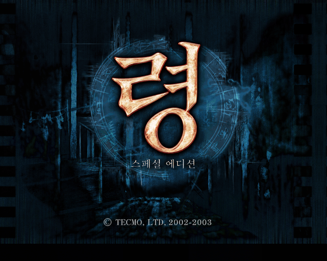
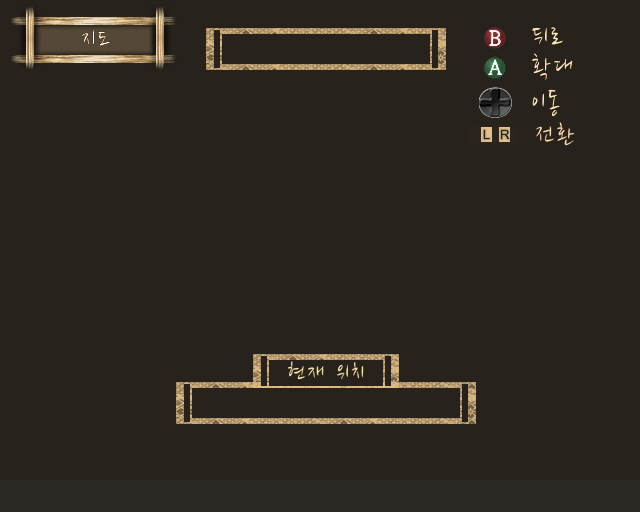
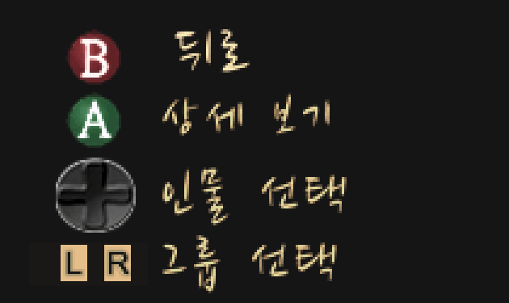
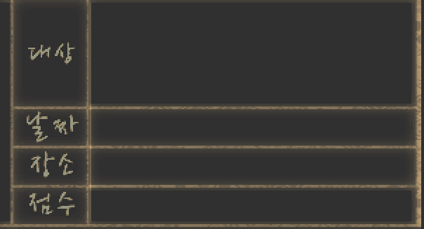
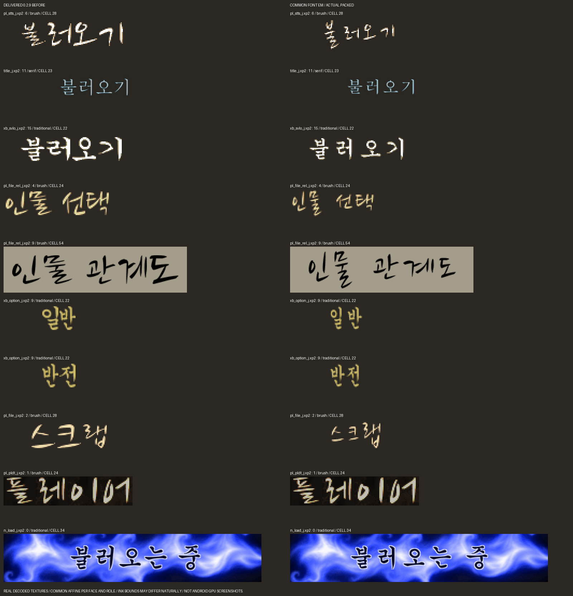

# XBOX 령 스페셜 에디션 한국어 패치 V0.8

오리지널 Xbox **Fatal Frame / Zero Special Edition 일본판**의 비공식 한국어 패치입니다.
대사·메뉴·영상 자막과 인게임 음성 자막을 반영하고, 원래 게임의 이미지 질감과 버튼 아이콘을 유지했습니다.

**코리아 로컬라이즈 GiKakNo**

**[V0.8 Windows EXE 패처 다운로드](https://github.com/OldManCraveGuitars-bit/XBOX-Fatal-Frame-Zero-Special-Edition-Kr/releases/tag/v0.8)**

**xemu 실행 주의 (2026-11-09): V0.8에서 첫 영상 뒤 서장 진행 중 멈춤을 실제로 재현했습니다.**
같은 PC에서 무패치 일본판 원본도 xemu 응답 없음이 발생했습니다. 자막 그리기를 전부 끈 진단본에서도 멈춤이 남았으며, 원인과 해결책은 아직 확정하지 못했습니다.
현재 V0.8의 xemu 정상 진행을 보장하지 않습니다. [실행 환경·비교 결과·실제 캡처](docs/XEMU-TEST-20261109.md)를 확인해 주세요.

## 적용 방법

1. Releases에서 `XBOX-Fatal-Frame-Zero-Special-Edition-Kr-V0.8-Windows-Patcher.zip`을 받아 압축을 풉니다.
2. `XBOX-Fatal-Frame-Zero-Special-Edition-Kr-V0.8-Patcher.exe`를 실행합니다.
3. 아래 SHA-256과 일치하는 **패치하지 않은 일본판 원본 ISO**를 선택합니다.
4. 새 ISO의 저장 위치를 지정하고 **한국어 ISO 만들기**를 누릅니다.
5. 완료 및 전체 해시 검사 통과 메시지를 확인한 뒤 생성된 ISO를 사용합니다.

Windows 64비트용이며 Python을 설치할 필요가 없습니다. 차분 데이터는 EXE에 들어 있습니다.
출력 폴더에는 2GB 이상의 여유 공간이 필요합니다.
패처는 원본 ISO와 기존 출력 파일을 덮어쓰지 않습니다. 이전 한글 패치 ISO는 입력으로 사용할 수 없습니다.

## V0.8 반영 내용

- 메시지 번역 본문 3,057개, 한국어 본문·메뉴 폰트 752글자 반영.
- 영상 자막 144개와 인게임 음성 자막 192개, 총 336개 적용.
- 타이틀 배경·령 로고·스페셜 에디션을 함께 중앙 정렬.
- 이미지 문구 642개를 역할·서체·크기별 86개 글리프 계열로 관리.
- ‘불러오기’의 ‘오’, 관계도의 ‘자·모·노·소’ 등 글자별 강제 확대에 따른 비례 차이 수정.
- 지도·설정·파일·관계도·사진의 글자 잘림·열 정렬·아이콘 겹침과 원문 잔여 픽셀 정리.
- 저장/불러오기 하단 문구 겹침, 일시 정지 제목, 선택 칸 정렬 수정.
- 자막의 검은 외곽선, 쉼표 위치, 저장 진행률의 `100.0%`, 원래 `No.` 표기 반영.

## 화면 미리보기

상단 타이틀과 아래 이미지는 **최종 ISO에서 읽은 텍스처와 실제 Xbox 코드의 좌표를 이용한 리소스 미리보기**입니다.
실제 안드로이드 플레이 캡처가 아닙니다. 개인 사진·작업용 원본·진단 로그는 배포하지 않습니다.

| 지도 안내와 현재 위치 | 인물 선택 / 그룹 선택 |
| --- | --- |
|  |  |

| 사진 정보의 대상·날짜·장소·점수 | 글자 비례 수정 전후 |
| --- | --- |
|  |  |

## 지원하는 원본과 결과 해시

| 항목 | 크기 | SHA-256 |
| --- | ---: | --- |
| `Fatal Frame - Zero Special Edition (Japan).iso` | 1,514,930,176바이트 | `9bd4b44960f74c672d270305b86b68e4c2d59613ad5c775872961d61ee36108c` |
| V0.8 결과 XISO | 1,514,471,424바이트 | `cf9520d7a245a637af0b3ee15234ba9a9c40930bddf937caded893568251599b` |

## 검증 범위와 남은 확인

배포 패처로 일본판 원본에서 전체 ISO를 다시 만든 뒤 최종 SHA-256을 대조합니다.
메시지 제어 코드·줄 폭·자막 파일, 642개 이미지 문구, 실제 글자 UV와 조작 안내 배치, ISO 전체 1,928개 파일을 검사했습니다.

위 검사는 파일과 코드 검사입니다. 2026-11-09 xemu 실행 검사에서는 서장 멈춤이 확인됐으며, 파일 검사 통과를 게임 진행 정상 확인으로 해석하면 안 됩니다.

**V0.8은 공개 시험판입니다.** 안드로이드 실제 GPU 표시·전편 진행·저장/불러오기·음성과 자막 동기의 최종 확인은 남아 있습니다.
속삭임 11개는 리테일 참고 자막을 기반으로 번역했으며 일본어 음성 직접 청취 검증은 끝나지 않았습니다.
전체 대사의 문맥별 수동 검수가 완료됐다는 의미는 아닙니다.
오류 제보에는 장면·사용 환경·화면을 함께 남겨 주세요.

## 배포 구성

다운로드에는 EXE 패처, 간단한 사용법, 체크섬과 외부 구성 요소의 라이선스만 포함합니다.
게임 ISO·추출 게임 파일·개발용 편집기·캐시·분석 기록·중복 빌드는 포함하지 않습니다.
이 저장소는 배포용 패처 소스, 설명과 미리보기, 최소 검증 요약을 관리합니다.

- [변경 내역](CHANGELOG.md)
- [패처 빌드 방법](docs/BUILD.md)
- [검증 요약](verification/release-checks.json)
- [외부 구성 요소](licenses/THIRD-PARTY.md)
