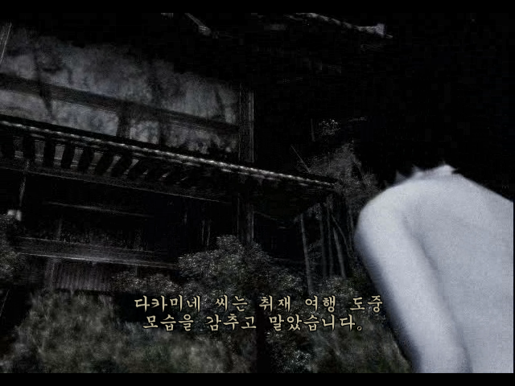
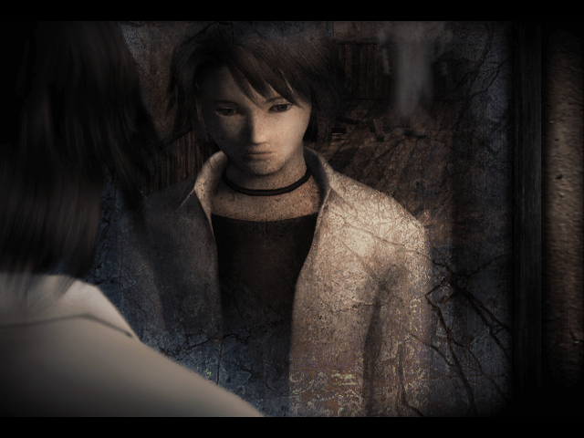

# xemu 실행 비교 — 2026-11-09

**V0.8의 서장 멈춤을 재현했습니다. 원본에서도 xemu 응답 없음이 발생해 패치만의 원인으로 단정할 수 없으며, 해결은 아직 검증하지 못했습니다.**

## 환경

- Windows 10 22H2, Intel Core i7-5820K, NVIDIA GTX 1080 Ti, 드라이버 582.28.
- 공식 xemu 0.8.139와 0.8.135. OpenGL 기본 배율 1, 별도 Vulkan 비교.
- Xbox 메모리 64MB. 각 실행에 같은 바이트의 HDD·EEPROM과 동일한 펌웨어 사용.
- HDD는 `-snapshot`으로 실행해 변경을 폐기. 기존 사용자 저장 데이터는 사용하지 않음.
- 원본 ISO SHA-256: `9bd4b44960f74c672d270305b86b68e4c2d59613ad5c775872961d61ee36108c`.
- V0.8 ISO SHA-256: `cf9520d7a245a637af0b3ee15234ba9a9c40930bddf937caded893568251599b`.

## 결과

| 입력 이미지 / 비교 조건 | xemu / 그래픽 | 관찰 결과 |
| --- | --- | --- |
| 무패치 일본판 원본, 첫 실행 | 0.8.139 / OpenGL | 실제 플레이 진입과 일시 정지 조작 확인 |
| 무패치 일본판 원본, 영상 자연 종료 재시험 | 0.8.139 / OpenGL | 전환 무렵 창과 QMP가 응답하지 않음 |
| V0.8, 영상 중 입력 없이 자연 종료 | 0.8.139 / OpenGL | 첫 영상 이후 거울 앞 마후유 장면에서 정지 |
| V0.8에서 자막 테두리 호출만 제외 | 0.8.139 / OpenGL | 같은 장면 정지 |
| V0.8에서 영상 자막 호출만 원래 코드로 복구 | 0.8.139 / OpenGL | 같은 장면 정지 |
| V0.8, 영상 자연 종료 | 0.8.139 / Vulkan | 같은 장면 정지 |
| V0.8, 영상 자연 종료 | 0.8.135 / OpenGL | 같은 장면 정지 |
| V0.8에서 일본어 경로의 자막 그리기 전체 차단, 첫 WMV만 건너뛰기 | 0.8.135 / OpenGL | 같은 후속 장면 정지. 자막 시계 0도 확인 |
| 무패치 일본판 원본, 첫 WMV만 건너뛰기 | 0.8.135 / OpenGL | 전환 후 창과 QMP가 응답하지 않음 |

진단본은 선택한 호출 또는 언어 게이트와 XBE 섹션 체크섬만 바꾼 별도 파일입니다. 배포 V0.8은 수정하지 않았습니다.
입력은 에뮬레이터의 GDB API로 실제 XInputGetState 반환 패킷에 전달했습니다. 입력용 실행 코드 패치는 사용하지 않았습니다. 스크린샷은 xemu 자체 F12 캡처입니다.

## 실제 실행 캡처

V0.8의 첫 영상에서 한글 자막이 표시된 화면입니다. 이것은 해당 장면의 표시 확인이며, 이후 진행 성공을 의미하지 않습니다.

V0.8에서 반복해서 고정된 후속 장면입니다. 원본 첫 영상 파일의 마지막 프레임과 다르므로, 단순히 영상 파일의 끝 화면이 남은 것으로 분류하지 않았습니다.

## 해석과 한계

자막 테두리, 영상 자막 호출, 전체 자막 그리기를 제외해도 멈춤이 남았습니다. 자막만 제거하는 방식은 해결책으로 확인되지 않았습니다.
멈춘 비교본에서는 네이티브 D3D_BlockOnTime 대기 기록을 얻었습니다. 추가 .KR 섹션이 배포 코드와 일치하는 것도 확인했지만, 이것만으로 전체 메모리 손상이나 패치 영향을 배제할 수는 없습니다.
원본도 불안정하므로 xemu·드라이버·게임 원본의 호환성 문제를 함께 조사해야 합니다. 정확한 원인은 미확정입니다.

서로 다른 환경의 기존 제보도 있으나 이 검사와 동일한 원인이라는 뜻은 아닙니다. 일본판의 로고 전 검은 화면은 [xemu #3060](https://github.com/xemu-project/xemu/issues/3060), 유럽판의 서장 내 간헐적 충돌은 [xemu #3059](https://github.com/xemu-project/xemu/issues/3059)에 보고되어 있습니다.

안드로이드 기기, 실제 Xbox, 전편 진행, 저장/불러오기 및 전체 음성 동기는 이번 검사로 검증하지 않았습니다. V0.8은 계속 공개 시험판이며, 이 기록은 수정 완료나 정상 진행 보증이 아닙니다.
